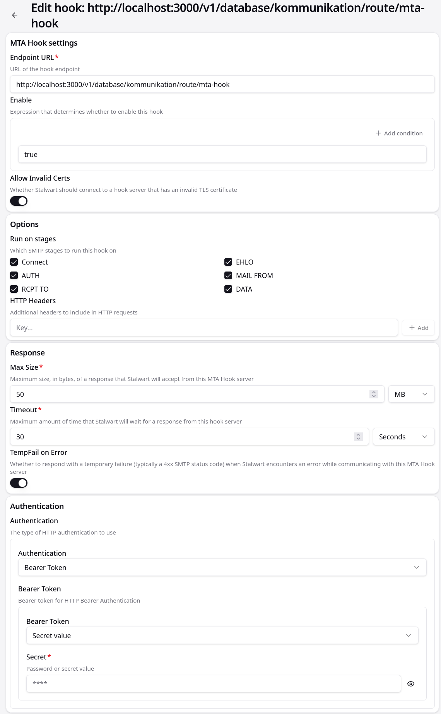

# MTA Hook Configuration

This page documents how the Kommunikationszentrum SpacetimeDB module accepts and processes MTA hooks from Stalwart. The module exposes an HTTP handler that implements per-stage processing and persists message deliveries to the database.

## Hook Protocol

The module implements the standard Stalwart MTA hook protocol. External systems POST a JSON payload for each SMTP stage to the module route. The request format follows the `stalwart_mta_hook_types::Request` type.

### Hook Request Format

A typical hook request contains `context` (stage, client/server metadata), optional `envelope`, and optional `message` fields. See the API Endpoints page for exact examples and test payloads.

### Hook Response Format

Handlers return a `stalwart_mta_hook_types::Response` JSON object with fields:

```json
{
  "action": "accept",
  "code": 250,
  "reason": "Message accepted",
  "modifications": [
    {
      "type": "add-header",
      "name": "X-Processed-By",
      "value": "SpacetimeDB Kommunikationszentrum"
    }
  ]
}
```

The possible actions are:
- `accept` (with or without modifications)
- `reject` (e.g., 550 for blocked IP during `CONNECT`)

> [!NOTE]
> **No quarantine action**: Unauthorized emails are not quarantined. Instead, for topic mail, the hook accepts the delivery at the MTA boundary, tags the subject with rejection details, and prevents subscriber fan-out within SpacetimeDB.

### Response Modifications

For the `DATA` stage:
- **Non-topic mail**: Pure pass-through. Returns `accept()` with empty modifications (no headers added, no database writes).
- **Accepted topic mail**: Adds header `X-Processed-By: SpacetimeDB Kommunikationszentrum`.
- **Rejected topic mail**: If any target topic is rejected, Stalwart modifies the `Subject` header via `Modification::change_header(1, "Subject", ...)` by appending ` (rejected from <topic1>, <topic2>)`. All envelope recipients remain intact (no recipients are removed). The clean original subject is preserved in SpacetimeDB `mail_message` for fan-out to accepted topics.

---

## Deployment and Configuration

In Stalwart MTA, configure the hook to POST to the SpacetimeDB module HTTP route:

```
POST http://localhost:3000/v1/database/kommunikation/route/mta-hook
```

For complete step-by-step setup in Stalwart, see [Stalwart MTA Setup — MTA Hook Configuration](./stalwart-setup.md#mta-hook-configuration).



- **Authentication**: External callers must provide `Authorization: Bearer <token>` carrying the `mta-hook` permission.
- **Token Generation**: For step-by-step instructions on generating, BLAKE3 hashing, and registering a webhook token, see [Managing Webhook Tokens / Token Generation](../core/spacetimedb/module-publishing.md#managing-webhook-tokens).

---

## Stage-Specific Handling

The SpacetimeDB handler executes validation and persistence logic for each SMTP stage inside atomic `ctx.with_tx(...)` transactions:

| Stage | Purpose | Detailed Documentation |
|---|---|---|
| `CONNECT` | IP blocklist check against `blocked_ips` table (550 reject if blocked, accept otherwise; zero DB writes) | [Processing Flow — CONNECT](./processing-flow.md#1-connect-stage) |
| `EHLO` | Protocol compliance (pass-through accept; zero DB writes) | [Processing Flow — EHLO](./processing-flow.md#2-ehlohelo-stage) |
| `MAIL FROM` | Sender envelope (pass-through accept; allows `<>` bounce senders; zero DB writes) | [Processing Flow — MAIL FROM](./processing-flow.md#3-mail-from-stage) |
| `RCPT TO` | Recipient envelope (pass-through accept; ensures regular and bounce mail passes; zero DB writes) | [Processing Flow — RCPT TO](./processing-flow.md#4-rcpt-to-stage) |
| `DATA` | Strict envelope topic detection, admission policy evaluation, subject suffixing, and fan-out queuing | [Processing Flow — DATA](./processing-flow.md#5-data-stage) |
| `AUTH` | Authentication pass-through (accept; zero DB writes) | [Processing Flow — AUTH](./processing-flow.md#6-auth-stage) |

For SpacetimeDB internal implementation details, table schemas, and reducer/transaction behavior, see [MTA Hook Processing (SpacetimeDB API)](../core/spacetimedb/http-handlers/mta-hook-processing.md).

---

## Operational Guidance: Fail-Open vs. Fail-Closed

When Stalwart forwards SMTP requests to SpacetimeDB, the hook request may occasionally fail (e.g., SpacetimeDB restarting, network partition, or execution timeout exceeding the configured limit). Stalwart provides the **TempFail on Error** setting to govern how these failures are handled:

### 1. Fail-Closed (`TempFail on Error` = Enabled / Default)

In fail-closed mode, any hook timeout or HTTP error causes Stalwart to return a temporary error (**SMTP 451** "Requested action aborted: local error in processing") to the connecting mail server.

- **Security & Integrity**: Unverified senders cannot post to topics during outages. No messages bypass SpacetimeDB's admission policy.
- **Delivery Impact**: External MTAs queue the message and retry delivery according to standard SMTP retry intervals (typically every 15–30 minutes over 4–5 days).
- **Personal Mail Side-Effect**: Inbound personal mail destined for individual mailboxes (e.g., `bob@solawis.de`) is also temporarily deferred while SpacetimeDB is unreachable.

### 2. Fail-Open (`TempFail on Error` = Disabled)

In fail-open mode, Stalwart logs the hook failure and continues normal SMTP message reception as if the hook had returned a plain `accept()`.

- **Availability**: Personal mail to regular mailboxes is delivered without delay, even if SpacetimeDB is completely down.
- **Security Trade-Off**: Incoming emails addressed to topic addresses will be accepted by Stalwart without SpacetimeDB validating sender subscriptions. However, because SpacetimeDB was not reached to create `mail_ingress` records, automatic subscriber fan-out does not take place until systems recover or manual intervention occurs.

### Recommended Configuration

| Environment / Priority | `TempFail on Error` | `Timeout` | Rationale |
|---|---|---|---|
| **High Security / Topic Protection (Default)** | **Enabled** | `30 Seconds` | Prevents unauthorized posts to mailing lists. Sending servers retry automatically. |
| **High Availability Personal Inboxes** | **Disabled** | `10 Seconds` | Guarantees personal mailboxes receive mail immediately during outages, accepting that list admission is skipped for the duration of the failure. |
