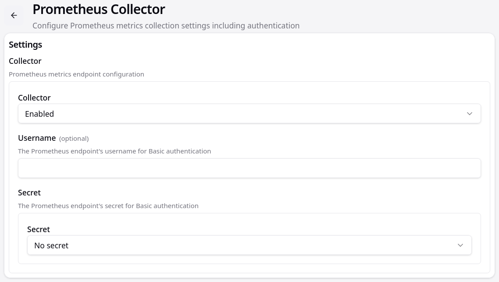
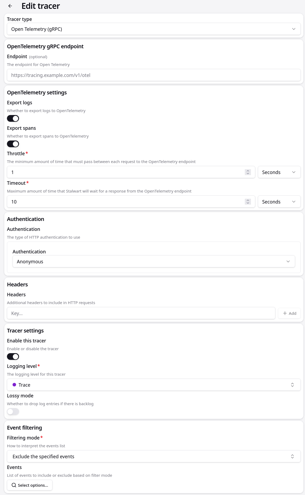

# Monitoring

The Kommunikationszentrum infrastructure monitors mail transport, HTTP hook delivery, database activity, and system health through Prometheus metrics, OpenTelemetry distributed tracing, and SpacetimeDB audit log tables.

---

## Stalwart MTA Metrics (Prometheus)

Stalwart exposes a built-in Prometheus collector endpoint on its HTTP listener port (`http://<stalwart-host>:8093/metrics/prometheus`).



### Collector Configuration

1. In the Stalwart Web Admin UI, navigate to **Settings → Telemetry / Metrics → Prometheus Collector**.
2. Set **Collector** to `Enabled`.
3. Set **Username** and **Secret** if basic authentication is needed (or `No secret` for internal network scraping).

### Prometheus Scrape Configuration

The repository includes a ready-to-use Prometheus scrape configuration in `grafana/prometheus.yaml`:

```yaml
global:
  scrape_interval: 15s
  evaluation_interval: 15s

scrape_configs:
  - job_name: 'prometheus'
    static_configs:
      - targets: ['localhost:9090']

  - job_name: 'stalwart'
    metrics_path: '/metrics/prometheus'
    metric_relabel_configs:
      - source_labels: [__name__]
        regex: '(.*)'
        replacement: 'stalwart_$1'
        target_label: __name__
        action: replace
    static_configs:
      - targets: ['host.containers.internal:8093']
```

Key Stalwart metrics exposed include:
- `stalwart_smtp_connections_total`: Inbound SMTP connection counts.
- `stalwart_smtp_messages_received_total`: Total accepted messages.
- `stalwart_mta_hook_requests_total`: Total webhook requests sent to SpacetimeDB.
- `stalwart_mta_hook_duration_seconds`: Hook round-trip latency.

---

## Distributed Tracing (OpenTelemetry)

Stalwart supports exporting trace spans and structured logs over gRPC to an OpenTelemetry collector (e.g. Jaeger or Grafana Tempo):



1. In the Stalwart Web Admin UI, navigate to **Settings → Telemetry / Tracing → Tracer**.
2. Configure:
   - **Tracer type**: `Open Telemetry (gRPC)`
   - **Endpoint**: Collector URL (e.g. `https://tracing.example.com/v1/otel`)
   - **Export logs**: Enabled
   - **Export spans**: Enabled
   - **Throttle**: `1 Seconds`
   - **Timeout**: `10 Seconds`
   - **Authentication**: `Anonymous` (or Bearer / Basic)
   - **Enable this tracer**: Enabled
   - **Logging level**: `Trace` (or `Info` for production)

---

## SpacetimeDB Delivery & Admission Monitoring

SpacetimeDB records per-topic admission outcomes and message deliveries:

| Table | Stage | Content |
|---|---|---|
| `received_message` | `DATA` | Per-topic delivery attempt: `mail_message_id`, `topic_id`, `topic_email`, `received_at`, and admission `disposition` (`Accepted` or `Rejected(reason)`). |
| `mail_ingress` | `DATA` | Inbound delivery queue for accepted messages waiting for fan-out processing by the sender daemon. |
| `system_mail_pending` | `DATA` | Outbound system notifications (such as rejection notices explaining why an email was rejected). |

### Inspecting Messages & Ingress via CLI

```bash
# Query recent received messages with admission disposition
spacetime sql kommunikation "SELECT id, topic_email, disposition, received_at FROM received_message ORDER BY received_at DESC LIMIT 10"

# Query pending fan-out ingress jobs
spacetime sql kommunikation "SELECT * FROM mail_ingress LIMIT 10"

# Query pending system notifications (rejection notices)
spacetime sql kommunikation "SELECT * FROM system_mail_pending LIMIT 10"
```
